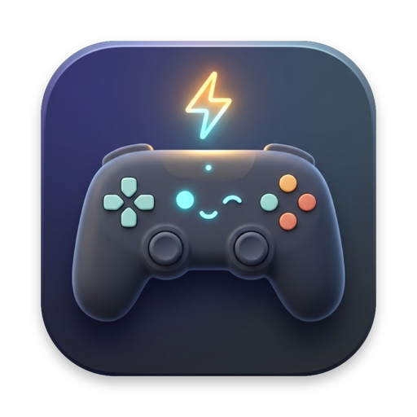

<div align="center">
  <a href="https://mindthelatency.github.io/padwake/">
    
  </a>

  <h1>PadWake</h1>

  <p>
    <strong>Wake your sleeping USB gamepad on macOS — plug in and play.</strong>
  </p>

  <p>
    A tiny, zero-dependency macOS menu-bar app &amp; IOKit utility for the Nintendo Switch 2 Pro Controller (<code>057E:2069</code>) over USB-C.
  </p>

  <p>
    <a href="https://mindthelatency.github.io/padwake/"></a>
    
    
    <a href="LICENSE"></a>
  </p>

  <p>
    <a href="#features">Features</a> &middot;
    <a href="#quick-start">Quick Start</a> &middot;
    <a href="#why-padwake">Why PadWake?</a> &middot;
    <a href="#cli--launchagent">CLI &amp; Daemon</a> &middot;
    <a href="#troubleshooting">Troubleshooting</a>
  </p>
</div>

---

Plugged a **Nintendo Switch 2 Pro Controller** (`VID 0x057E / PID 0x2069`) into your Mac over USB-C and games act like nothing is connected?

**PadWake** sits quietly in your menu bar, wakes the controller automatically the moment you plug it in, lights up your Player LED, and fixes macOS's SDL2 controller veto — with **no Homebrew, no `libusb`, no kernel extensions, and no `sudo`**.

---

## Features

- **Automatic USB-C Wake** — Event-driven IOKit hotplug watcher (`~0%` idle CPU) sends the wake handshake whenever the controller is connected.
- **Fixes macOS's SDL2 Veto** — One-click toggle sets `SDL_JOYSTICK_MFI=0` for your session so SDL2 games actually see the controller.
- **Built-in Game Profiles & WoW: Forever Class Presets** — Auto-detects *World of Warcraft* (`_forever_`, `_classic_`, `_retail_`) `WTF/` folders for 1-click installs, includes optimized **9-class WoW: Forever controller profiles** (`PadWakeProfiles` companion addon — Native `C_GamePad` & ConsolePort-aware), plus a **Generic SDL2** profile for any other game.
- **Player LEDs & Live Input Tester** — Switch `P1`–`P4` LEDs and live-test all **21 buttons** (including rear grip paddles `GL`, `GR`, and `C`) plus both 12-bit analog sticks.
- **Native macOS Menu-Bar App** — Built with SwiftUI `MenuBarExtra` + pure C11 IOKit, native **Launch at Login** (`SMAppService`), and a right-click menu to wake or quit.

---

## Quick Start

> **Prerequisite:** Apple's Xcode Command Line Tools (`xcode-select --install`). No Homebrew or third-party libraries needed.

### Menu-Bar App (`PadWake.app`) — Recommended

```bash
git clone https://github.com/mindthelatency/padwake.git
cd padwake
make install-app
```

Then finish setup in 10 seconds:
1. Click the **gamepad icon** in your macOS menu bar.
2. Check **Launch at Login** so PadWake starts automatically.
3. Expand **Game Profiles** to install mappings into your game folder (e.g. 1-click install for auto-detected *World of Warcraft* `WTF/` folders, with optional class preset selection).
4. **Restart your game launcher once** so it picks up `SDL_JOYSTICK_MFI=0`.
5. *(WoW: Forever)* Type `/padwake apply` in-game to apply your class's optimized `C_GamePad` CVars, rear-paddle bindings, and starter macros.

<details>
<summary><strong>World of Warcraft: Forever — 9-Class Controller Profiles (Native &amp; ConsolePort)</strong></summary>

Installing the **World of Warcraft** profile from `PadWake.app` (or `./scripts/install-wow-forever.sh [--class <name>]`) installs `gamecontrollerdb.txt`, `GamePadConfig_PadWake.json`, and the lightweight `PadWakeProfiles` companion addon into `Interface/AddOns/PadWakeProfiles/`.

- **All 9 classes included:** Warrior, Paladin, Hunter, Rogue, Priest, Shaman, Mage, Warlock, and Druid — see [games/wow/classes/README.md](games/wow/classes/README.md) for the full button, paddle (`GR`/`GL`/`C`), and macro guide.
- **Cloud-sync safe:** Uses Blizzard's `SetBinding` / `SaveBindings` / `SetCVar` / `CreateMacro` APIs in-game so `synchronizeBindings` never overwrites your setup.
- **ConsolePort-aware:** Automatically detects if **ConsolePort** is loaded and preserves ConsolePort's `PAD*` bindings while still applying class CVars and `PW_*` starter macros (pass `/padwake apply --force-bindings` to override).
- **Commands:** `/padwake apply [class]`, `/padwake cvars`, `/padwake macros`, `/padwake info`, `/padwake reset`.

</details>

> **Tip:** Right-click (or Control-click) the menu-bar icon anytime to quickly **Wake Controller** or **Quit PadWake**.

---

## Why PadWake?

Two macOS quirks prevent `057E:2069` from working in games out of the box over USB-C:

1. **Silent USB Boot State** — When plugged in, the controller sends zero HID input reports until the host sends a short USB initialization handshake and Player LED packet over Vendor Interface 1.
2. **macOS `GCController` / SDL2 MFi Veto** — Recent macOS versions report `GCController` support for `057E:2069` without publishing a controller, causing SDL2's IOKit backend to skip it. Setting `SDL_JOYSTICK_MFI=0` lets SDL2 read the native USB HID stream directly.

<details>
<summary><strong>Technical &amp; HID protocol details</strong></summary>

- **Interface 0 (`If_Hid`, USB HID Game Pad):** Already parsed by macOS `AppleUserUSBHostHIDDevice` with standard **HID Report `0x09`** — 21 buttons + 4×12-bit analog axes (`X`, `Y`, `Rx`, `Rz`), readable directly by `IOHIDManager` and SDL2.
- **Interface 1 (Vendor Class `0xFF`, Bulk OUT `EP 0x02` / Bulk IN `EP 0x82`):** Unclaimed by macOS kernel drivers. PadWake opens it via native `IOUSBInterfaceInterface300` and sends:
  - **Wake handshake:** `03 91 00 0d 00 08 00 00 01 00 ff ff ff ff ff ff`
  - **Player LED (`P1`–`P4`):** `09 91 00 07 00 08 00 00 <mask> 00 00 00 00 00 00 00`
- **Extra buttons &amp; rear paddles mapping:** `GR` → `PADPADDLE1` (`b18`), `GL` → `PADPADDLE2` (`b19`), `C` → `PADPADDLE3` (`b20`), `Capture` → `PADSOCIAL` (`b17`).

</details>

---

## CLI &amp; LaunchAgent

Prefer a headless terminal tool instead of the menu-bar app? PadWake also builds a standalone IOKit CLI (`bin/padwake`).

<details>
<summary><strong>Show CLI commands &amp; background LaunchAgent setup</strong></summary>

```bash
# Build the standalone CLI (links only IOKit + CoreFoundation)
make

# Wake the connected controller and verify live HID Report 0x09 streaming
./bin/padwake enable

# Optional: install WoW Forever mappings via script
make install-wow

# Optional: run as a background LaunchAgent (auto-wakes + sets SDL_JOYSTICK_MFI=0)
make install-daemon
```

| Command | Description |
|---|---|
| `make` | Build `bin/padwake` |
| `make app` / `make install-app` | Build &amp; install `/Applications/PadWake.app` |
| `./bin/padwake status` | Check USB/HID presence and whether HID reports are streaming |
| `./bin/padwake enable [--led 1-4]` | Send USB wake handshake + Player LED command and verify HID stream |
| `./bin/padwake watch [--led 1-4]` | Stay running and auto-wake on USB hotplug via IOKit notifications |
| `./bin/padwake monitor` | Live-decode all 21 buttons and both 12-bit analog sticks |
| `make install-wow` | Install `gamecontrollerdb.txt`, `GamePadConfig_PadWake.json`, and `GamePadEnable` |
| `make launch-wow` | Wake controller and launch *World of Warcraft Forever* with `SDL_JOYSTICK_MFI=0` |
| `make install-daemon` / `uninstall-daemon` | Install or remove the CLI `LaunchAgent` (`~/Library/Logs/padwake.log`) |

> If you switch from the CLI `LaunchAgent` to `PadWake.app`, run `make uninstall-daemon` so only `PadWake.app` manages hotplug waking.

</details>

---

## Troubleshooting

<details>
<summary><strong>Controller is awake in PadWake, but my game still shows 0 controllers</strong></summary>

Make sure **Fix macOS SDL2 MFi Veto** is toggled on in PadWake, then **completely quit and reopen your game launcher** (e.g. Battle.net / Steam) and the game so the process inherits `SDL_JOYSTICK_MFI=0`.

In *World of Warcraft*, you can verify device detection in chat with:
```text
/dump C_GamePad.GetAllDeviceIDs()
```

</details>

<details>
<summary><strong>Up/down analog stick movement feels inverted</strong></summary>

Remove the `~` from `lefty:a1~` / `righty:a3~` in [games/sdl2/gamecontrollerdb_padwake.txt](games/sdl2/gamecontrollerdb_padwake.txt) (or add `"scale": -1` to `LStickY` / `RStickY` in [games/wow/GamePadConfig_PadWake.json](games/wow/GamePadConfig_PadWake.json)), then reinstall the profile.

</details>

<details>
<summary><strong>Building a signed &amp; notarized release DMG (for maintainers)</strong></summary>

With an Apple **Developer ID Application** certificate and a `notarytool` keychain profile:

```bash
DEVELOPER_ID="Developer ID Application: Your Name (TEAMID)" \
NOTARY_PROFILE="padwake-notary" \
make release
```

This builds a **Universal Binary (`arm64` + `x86_64`)**, signs with Hardened Runtime, creates a drag-to-Applications `.dmg`, submits to Apple Notary Service, staples the ticket, and verifies Gatekeeper acceptance.

</details>

---

## Disclaimer &amp; License

> PadWake is an independent open-source interoperability utility. It is not affiliated with, endorsed by, or sponsored by Nintendo Co., Ltd., Blizzard Entertainment, Inc., or Apple Inc. All trademarks belong to their respective owners.

Released under the [MIT License](LICENSE).
